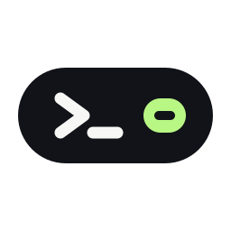
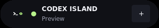
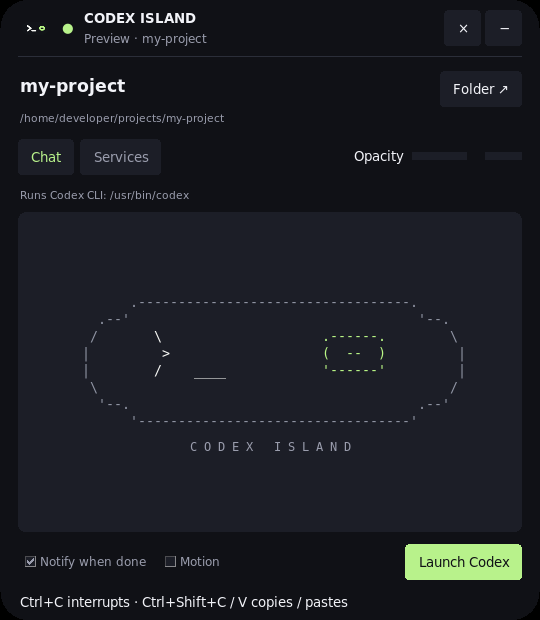

<p align="center">
  
</p>

# Codex Island

**A floating Codex terminal and local service controls for Linux.**

Keep Codex within reach while you work. Codex Island sits above your desktop as a
small, translucent pill. Click to expand it into a real terminal, launch Codex in
your project folder, and receive a desktop notification when a turn completes.

An independent desktop companion for the Codex CLI.

## Features

- **Animated ASCII logo** — a floating capsule, terminal prompt, blinking cursor,
  and lime toggle on the launch screen; the Motion setting also controls this animation.
- **Real terminal** — native GTK3/VTE rendering, ANSI colors, cursor movement,
  scrollback, resizing, and direct keyboard input.
- **Launch Codex** — starts the installed CLI in your chosen directory with your
  existing sign-in and configuration.
- **Compact island** — a draggable 320 × 58 pill that expands on a click.
- **Translucent surface** — adjustable opacity with rounded panels and buttons.
- **Motion effects** — eased expansion, hover fades, press effects, and a status
  pulse; reduced motion is available.
- **Completion notifications** — follow turns started inside the island.
- **Local services** — inspect running Docker containers and listening TCP/UDP
  ports, then stop supported services through confirmed GUI actions.
- **Manual terminal control** — Ctrl+C belongs to Codex. There is no terminal Stop
  button, and the island does not close a running CLI session for you.

## Screenshots

**Compact**



**Expanded**



These screenshots show preview mode, before launching Codex. They contain no
private conversations or desktop background. Project and executable paths in the
public screenshots are illustrative.

## Brand assets

The project logo and its raster sizes, wordmark, tile, and monochrome variants
are included in [`assets/branding`](assets/branding). The desktop shortcut uses
`assets/branding/codex-island.svg`, and the app header and window icon use the matching PNG assets.

## Requirements

| Dependency | Purpose |
| --- | --- |
| Linux with X11 or XWayland | Native window and terminal embedding |
| Python 3.10+ and Tk 8.6 | Desktop interface |
| GTK3 and VTE 2.91 shared libraries | Real terminal engine |
| Codex CLI on `PATH` | Interactive Codex session |
| `ss` from iproute2 | Listening-port inspection |
| `notify-send` and a notification daemon | Desktop notifications |
| Docker CLI and a local daemon, optional | Container inspection and stopping |

No pip installation, Python virtual environment, or VTE introspection typelib is
needed. The terminal loads the installed native libraries directly. Transparency
requires a desktop compositor; safe port stopping requires Linux pidfd support.

The current implementation has been tested on a Linux desktop with Codex CLI
0.162.1. Other distributions and CLI versions have not been comprehensively tested.

## Quick start

Download or clone the project, then run these commands from the directory
containing `launch.sh`.

### 1. Install system dependencies

On Ubuntu/Debian:

```sh
sudo apt update
sudo apt install python3-tk libvte-2.91-0 iproute2 libnotify-bin
```

The GTK3 VTE package brings in its native dependencies. On other distributions,
install equivalent packages using your system package manager. See the
[Ubuntu VTE package](https://packages.ubuntu.com/noble/libvte-2.91-0) for the
GTK3 runtime dependency list. Docker is optional and configured separately.

### 2. Set up Codex

Install the CLI using the [official Codex installation guide](https://learn.chatgpt.com/docs/cli),
then sign in from a normal terminal:

```sh
codex login
```

The island uses the installed CLI's authentication; it has no separate sign-in
screen or credential store.

### 3. Open the island

```sh
./launch.sh --folder /path/to/your/project
```

Alternatively:

```sh
python3 src/island.py --folder /path/to/your/project
```

Click the pill to expand it, then press **Launch Codex** in the Chat tab. Type
directly in the terminal. Codex starts only when you press Launch.

## Controls

| Control | Action |
| --- | --- |
| Click the header or + / − | Expand or collapse |
| Drag the header | Reposition the island |
| Folder | Open a non-blocking project-folder picker; no program launches |
| Launch Codex | Start Codex inside the terminal |
| Focus terminal | Return keyboard focus to a running CLI |
| Ctrl+C, inside the terminal | Interrupt Codex using its native controls |
| Ctrl+Shift+C / Ctrl+Shift+V | Copy selected text / paste |
| Services → Stop | Confirm stopping a container or supported listener |
| Opacity | Adjust whole-window translucency |
| Motion | Enable or disable animation |
| Notify when done | Toggle desktop completion notifications |
| × | Close after manually exiting Codex |

The Folder picker supports browsing or pasting a path, with Cancel and Use this
folder controls. The island temporarily hides so it cannot cover the picker,
then returns when you select or cancel. Folder loading happens in the background.
Only **Launch Codex** starts a program; its executable path is shown above the
terminal, and the selected directory is shown under the project name.

Exit the CLI before changing folders or closing the island. Terminal keystrokes,
including Escape, go to Codex. The island's Escape and Ctrl+Q shortcuts apply
when its own interface has keyboard focus.

### Launch options

```sh
./launch.sh --preview
./launch.sh --reduced-motion
./launch.sh --folder /path/to/project --reduced-motion
python3 src/island.py --help
```

`--preview` opens the interface without launching Codex. `--reduced-motion`
uses immediate transitions. Without `--folder`, the current working directory
becomes the initial project folder. Settings are kept for the current app session.

### Application-menu shortcut

```sh
python3 scripts/install_launcher.py --folder /path/to/your/project
```

Then search for **Codex Island** in your desktop launcher. Omitting `--folder`
uses the app directory. The shortcut points to this checkout; reinstall it after
moving the app. It does not enable autostart or require sudo. To remove the
shortcut, delete `~/.local/share/applications/codex-island.desktop`.

## Notifications

A process-local [Codex notify hook](https://learn.chatgpt.com/docs/config-file/config-advanced#notifications)
forwards only an `agent-turn-complete` marker through a private Unix socket.
Prompts and assistant messages are discarded by the bridge. Your saved Codex
configuration is unchanged; its existing `notify` command is replaced only for
CLI sessions launched here.

Notifications cover these sessions only. Existing external terminals are not
attached. CLI exit and Ctrl+C are separate from completion. There is no
independent failure or approval-notification stream: those details remain inside
Codex. Elapsed time starts when Enter is pressed and measures terminal
interaction, rather than authoritative model execution time.

## Service controls and privacy

Each service has a Stop button. The GUI asks for confirmation and shows
**Stopping…**, a result, or an error. Protected and unknown-owner listeners are
**Read-only**. Stopping a process closes all its ports; a supervisor may restart it.

Listener stops require same-user ownership, an unchanged process identity, a
fresh listener match, and pidfd signalling. The island, its ancestors, and its
terminal process tree are protected. Docker targets the local rootless socket
when present, otherwise `/var/run/docker.sock`; remote Docker contexts are ignored.
No sudo or force-kill is exposed, and closing the island does not stop services.

The app does not persist terminal contents, credentials, or environment values.
Terminal output stays inside VTE; helper stdio carries lifecycle metadata and
focus/resize controls. Codex manages its own authentication and history. Local
Docker access uses your existing daemon permissions.

## Troubleshooting

| Symptom | What to check |
| --- | --- |
| The desktop window cannot open | Run from a desktop session with X11/XWayland available. |
| GTK3/VTE is missing | Install the GTK3 VTE runtime, not just the GTK4 variant. |
| Codex cannot launch | Check `codex --version`, sign in, and verify the selected folder exists. |
| Typing goes elsewhere | Click the terminal or use Focus terminal. |
| Notifications do not appear | Check Notify when done, `notify-send`, and your notification daemon. |
| A service is Read-only | Its owner may be unavailable, protected, or another user. |
| Docker cannot be inspected | Check that the local daemon is running and your account can access its socket. |
| Transparency or rounding differs | Your compositor and X11 Shape support determine these effects. |

Native Wayland layer-shell, background blur, a system tray, automatic attachment
to other terminals, and Windows/macOS support are not implemented.

## Development

The application uses the Python standard library and installed native libraries.
Keep changes local to this project and avoid persisting terminal or credential data.

| File | Responsibility |
| --- | --- |
| `src/island.py` | Window, terminal launch UI, service cards, status, and controls |
| `src/terminal_host.py` | Native GTK3/VTE rendering and X11 embedding |
| `src/terminal_session.py` | Owned helper lifecycle and private notification socket |
| `src/notify_bridge.py` | Completion-only Codex notification bridge |
| `src/runtime.py` | Docker, listener inspection, safe process stopping, and notifications |
| `src/folder_picker.py` | Responsive project-directory selection without launching a program |
| `src/ascii_logo.py` | Animated ASCII launch-screen logo |
| `src/widgets.py`, `src/motion.py`, `src/window_shape.py` | Rounded surfaces, cancellable animations, and X11 shaping |
| `scripts/install_launcher.py`, `launch.sh` | Desktop shortcut and launch entry points |
| `tests/` | Runtime, terminal, and opt-in desktop regression tests |

Run the headless checks:

```sh
python3 -m unittest discover -s tests -v
python3 -m compileall -q src scripts tests
```

For desktop checks, install ImageMagick and `xdotool`, then run:

```sh
CODEX_ISLAND_UI_TEST=1 python3 -m unittest discover -s tests -v
```

Desktop tests briefly open windows, type controlled input into an owned test
terminal, exercise resizing and Ctrl+C, and stop an owned disposable listener.
They save app-only screenshots under `/tmp`. Tests do not make paid model calls
or stop existing containers. Unix socket tests skip when sandbox policy forbids
binding. CI also exercises the desktop suite under a virtual X11 desktop.

## Repository and showcase

Application code lives in `src/`, maintainer tools in `scripts/`, and the
Pages-ready HTML showcase in `site/`. See [architecture](docs/ARCHITECTURE.md)
for the full layout and [release/Pages instructions](docs/RELEASING.md) for CI,
draft source releases, and later publication.

```sh
python3 scripts/build_site.py
python3 -m http.server 8000 --bind 127.0.0.1 --directory dist/site
```

Open `http://127.0.0.1:8000/`. The showcase has an interactive island preview
and a separate installation guide. Website service actions are simulations.

### Contributing

See [CONTRIBUTING.md](CONTRIBUTING.md) for checks and pull requests,
[SECURITY.md](SECURITY.md) for sensitive reports, and [AGENTS.md](AGENTS.md)
for implementation boundaries. GitHub issue and pull-request templates are included.

## License

[MIT](LICENSE). External software, including Codex CLI and native system libraries,
retains its own licensing. This is an independent project, not affiliated with or
endorsed by OpenAI.

The island uses a desktop-managed window with its title bar hidden so GNOME can
recognize app-menu launches. Re-run `python3 scripts/install_launcher.py` after
moving or updating the app to refresh its desktop shortcut.
